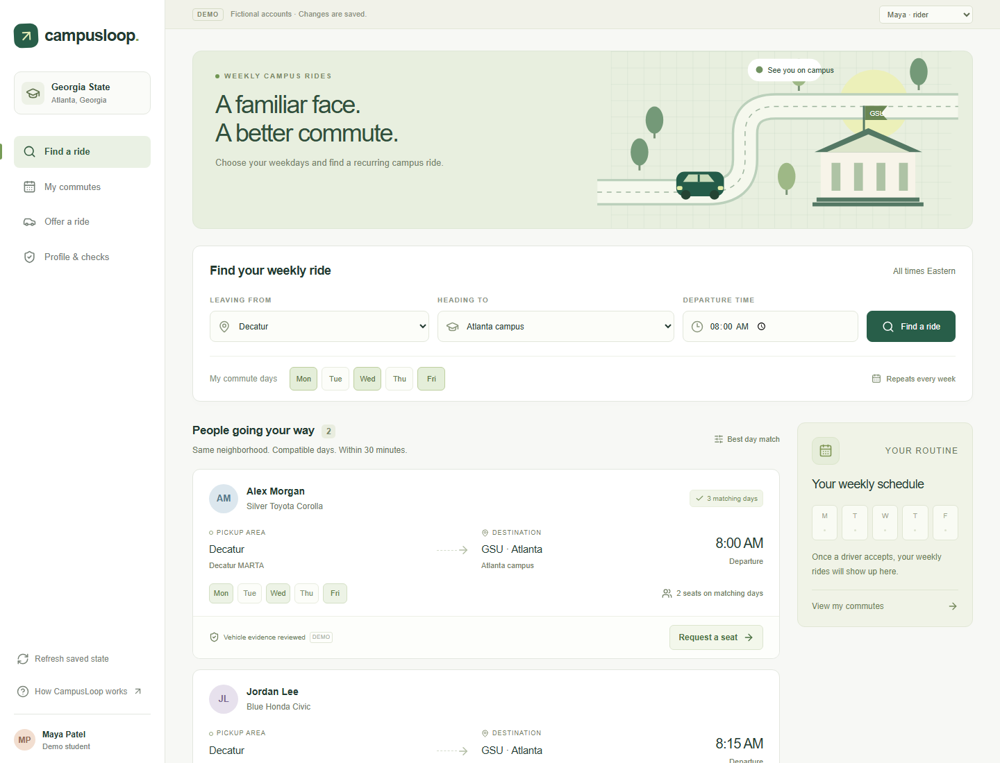

# CampusLoop

Weekly campus rides. Search for a ride, request a seat, and manage each date after the driver accepts.



## What it does

- Match rides by neighborhood, campus, weekdays, and departure time (within 30 minutes).
- A seat is reserved only after the driver accepts the request. Each weekday has its own seat count.
- Cancel one date or the whole weekly series. Check in, mark a ride complete, or report a no-show for that date only.
- Drivers can post a weekly offer once a vehicle is reviewed.
- A campus reviewer can look at reports and vehicle documents. Nothing applies a penalty on its own.

Sample people are already in the app: Maya (rider), Alex (driver), Jordan (driver), and a campus reviewer. Everyone on this computer shares that same workspace. There is no separate login.

## Run

Install Node.js 22.13 or newer, then:

```sh
npm ci
npm run setup
npm run dev
```

Open http://127.0.0.1:5173.

`npm run setup` builds the app and creates the local database. You can run it again. After that, `npm run dev` is enough. Stop the server with Ctrl+C. For the built app instead of the dev server, use `npm start`. Run only one server at a time.

The app stays on your computer. It does not need a Cloudflare or Supabase account. Saved rides and uploads live in `.wrangler/`, which is not committed.

## Try a ride

1. Stay on Maya. The default search is Decatur to Atlanta campus, 8:00 AM, Monday / Wednesday / Friday.
2. Request Alex's ride. Turn Friday off and send Monday and Wednesday. It shows as awaiting approval. No seat is held yet.
3. Switch to Alex. Open My commutes, accept Maya, then check the driving list. Monday and Wednesday each have one seat left. Friday still has two.
4. Switch back to Maya. My commutes shows the weekly plan and the upcoming dates.
5. Cancel one future Wednesday from Manage. Only that date is canceled. The next Wednesday stays on the schedule, and Alex gets that seat back.
6. On another date, choose Manage, then rehearse that ride day. The clock moves to five minutes after departure. Check in, mark it complete, or report a driver no-show. Only that date changes.
7. If the rider reports a no-show and the driver checks in, the campus reviewer can read it and add a note.
8. Leave rehearsal from the banner. To start clean, switch to the campus reviewer and reset the demo. The latest reset can be undone.

A few other things worth clicking:

- Maya cannot offer a ride until a vehicle is approved.
- Profile & checks accepts a PDF, JPEG, or PNG for registration and insurance. The reviewer can approve, ask for changes, reject, or suspend.
- Alex can post another weekly offer if it does not overlap. Two offers cannot leave within an hour on the same weekday.
- Pause new requests keeps rides that are already confirmed. Cancel series drops future dates.
- A neighborhood with no drivers shows an empty search. That is expected.

## Checks

```sh
npm test
npm run typecheck
npm run build
```

With the server running:

```sh
npm run test:api
```

The API check changes the sample data. Reset the demo from the campus reviewer when you are done.

## Code

| Path | What it is |
| --- | --- |
| `components/campus-loop.tsx` | App shell and navigation |
| `components/campus/` | Screens, dialogs, and client state |
| `app/globals.css` | Styles |
| `lib/commutes.mjs` | Matching, weekly rides, and seat rules |
| `lib/server.ts` | Saved workspace and database updates |
| `app/api/` | Search, actions, documents, and credentials |
| `db/`, `drizzle/` | Schema and migrations |
| `scripts/` | Local launch and database setup |
| `tests/` | Domain and API checks |

Mailbox checks, vehicle reviews, and the people in the app are sample data. Real student login is not built. An optional credential check can be turned on later in [docs/CREDENCE.md](docs/CREDENCE.md). More detail on how matching and storage work is in [docs/ARCHITECTURE.md](docs/ARCHITECTURE.md).
